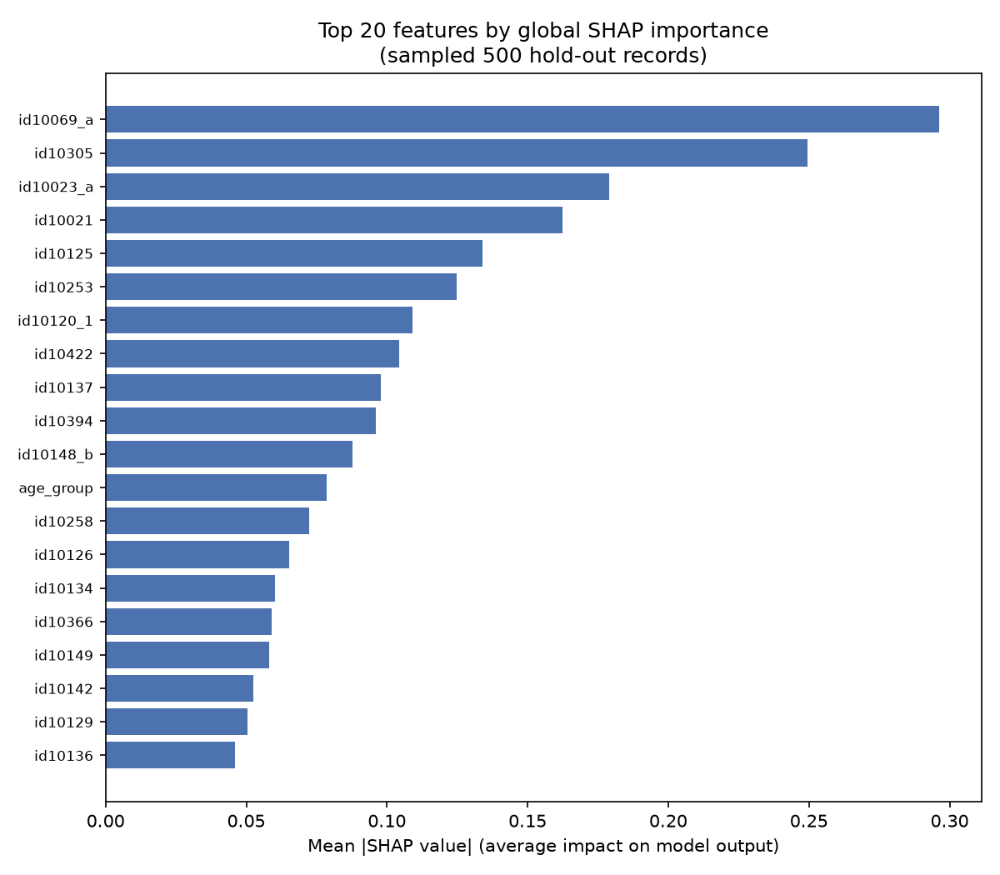
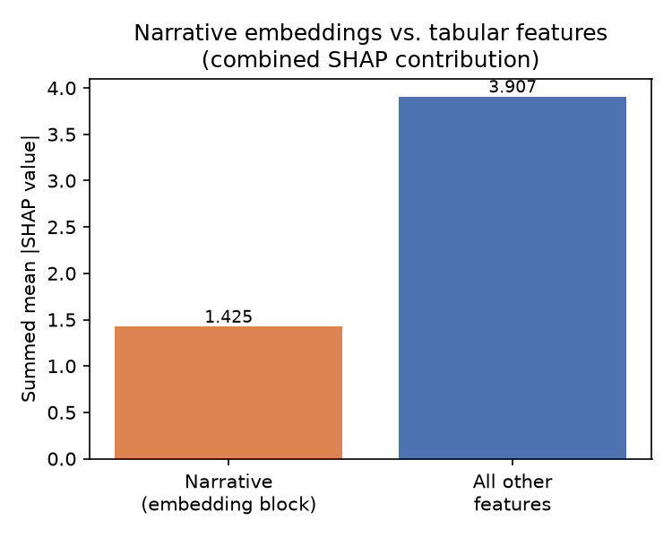

# Training Summary — v1.3.1

## Model Upload Info

Values to paste into the VMan3 admin panel upload form (Settings → Configurations → VMan ML). Accuracy/F1 figures are from the hold-out set (20%, never seen during training) - the representative real-world estimate, not the internal validation split used only to pick between candidate models.

| Field | Value |
|---|---|
| Version | v1.3.1 |
| Notes | Combined model trained on 3 input file(s) (2016_tz, 2022_es, 2022_tz); 8972 rows after quality filtering; best model: XGBoost.  _(draft — edit before uploading)_ |
| Accuracy | 0.893 |
| F1 macro | 0.841 |
| F1 weighted | 0.8895 |
| CV F1 macro | 0.8703 |
| Training samples |  |
| Test samples | 1795 |

## Inputs
- Input files: vman_ml/resources/train16_tz.csv, vman_ml/resources/train22_es.csv, vman_ml/resources/train22_ng.csv
- Target column: `pcva_who_cod`
- Instrument version(s): 2016_tz, 2022_es, 2022_tz
- Feature count: 499

## Data Pipeline
| Stage | Rows |
|---|---|
| Input rows | 9455 |
| After quality filter | 9147 |
| After rare-cause clustering | 9147 |
| Final rows used for training | 8972 |

### Rows dropped, by reason
| Reason | Rows dropped |
|---|---|
| Missing/unknown cause label | 287 |
| WHO causelist mapping failure | 175 |
| Demographic-cause implausibility | 20 |
| vman_dq pregnancy/sex contradiction | 1 |
| vman_dq low ICI (< 70%) | 0 |

vman_dq ICI: 9148 rows scored, mean ICI 99.87%, rules applied: C2, C3, C4, C5

**Rare-cause clustering:** 43 causes grouped into 13 cluster group(s) (causes below `--min_vc` records).

## Model Comparison (internal validation split)
| Model | CV Macro-F1 | Val Accuracy | Val Macro-F1 | Fit Time (s) |
|---|---|---|---|---|
| XGBoost | 0.8703 | 0.9025 | 0.8779 | 3296.0 |
| RandomForest | 0.7646 | 0.7939 | 0.7538 | 41.4 |

**Selected model:** XGBoost

## Timing
| Phase | Duration |
|---|---|
| Hyperparameter search (model fitting only) | 55m37s |
| Total run (data load, preprocessing, embeddings, search, eval) | 55m57s |

## Validation Results
| Metric | Value |
|---|---|
| Records | 1436 |
| Accuracy | 0.9025 |
| Macro-F1 | 0.8779 |
| Weighted-F1 | 0.9004 |
| Macro-AUROC |  |

## Hold-out Test Results (20%, never seen during training)
| Metric | Value |
|---|---|
| Records | 1795 |
| Accuracy | 0.893 |
| Macro-F1 | 0.841 |
| Weighted-F1 | 0.8895 |
| Macro-AUROC |  |

### Per-cause performance on hold-out (worst 15 by F1)
| Cause | Precision | Recall | F1 | AUROC | Support |
|---|---|---|---|---|---|
| cluster_nutritional_and_endocrine_disorders | 0.000 | 0.000 | 0.000 | n/a | 5 |
| Pregnancy-induced hypertension | 0.767 | 0.575 | 0.657 | n/a | 40 |
| cluster_non_communicable_diseases | 0.833 | 0.556 | 0.667 | n/a | 9 |
| cluster_gastrointestinal_disorders | 0.778 | 0.636 | 0.700 | n/a | 22 |
| cluster_infectious_and_parasitic_diseases | 0.808 | 0.677 | 0.737 | n/a | 31 |
| Other and unspecified maternal cause | 0.733 | 0.786 | 0.759 | n/a | 42 |
| Sepsis | 0.800 | 0.750 | 0.774 | n/a | 32 |
| Measles | 0.938 | 0.692 | 0.796 | n/a | 65 |
| Obstetric haemorrhage | 0.776 | 0.835 | 0.804 | n/a | 91 |
| Acute respiratory infection, including pneumonia | 0.842 | 0.780 | 0.810 | n/a | 82 |
| Severe malnutrition | 0.952 | 0.714 | 0.816 | n/a | 28 |
| Neonatal sepsis | 0.914 | 0.768 | 0.835 | n/a | 69 |
| cluster_renal_disorders | 0.857 | 0.857 | 0.857 | n/a | 14 |
| cluster_neoplasms | 0.911 | 0.854 | 0.882 | n/a | 48 |
| cluster_diseases_of_the_circulatory_system | 0.905 | 0.864 | 0.884 | n/a | 22 |

All causes

| Cause | Precision | Recall | F1 | AUROC | Support |
|---|---|---|---|---|---|
| cluster_nutritional_and_endocrine_disorders | 0.000 | 0.000 | 0.000 | n/a | 5 |
| Pregnancy-induced hypertension | 0.767 | 0.575 | 0.657 | n/a | 40 |
| cluster_non_communicable_diseases | 0.833 | 0.556 | 0.667 | n/a | 9 |
| cluster_gastrointestinal_disorders | 0.778 | 0.636 | 0.700 | n/a | 22 |
| cluster_infectious_and_parasitic_diseases | 0.808 | 0.677 | 0.737 | n/a | 31 |
| Other and unspecified maternal cause | 0.733 | 0.786 | 0.759 | n/a | 42 |
| Sepsis | 0.800 | 0.750 | 0.774 | n/a | 32 |
| Measles | 0.938 | 0.692 | 0.796 | n/a | 65 |
| Obstetric haemorrhage | 0.776 | 0.835 | 0.804 | n/a | 91 |
| Acute respiratory infection, including pneumonia | 0.842 | 0.780 | 0.810 | n/a | 82 |
| Severe malnutrition | 0.952 | 0.714 | 0.816 | n/a | 28 |
| Neonatal sepsis | 0.914 | 0.768 | 0.835 | n/a | 69 |
| cluster_renal_disorders | 0.857 | 0.857 | 0.857 | n/a | 14 |
| cluster_neoplasms | 0.911 | 0.854 | 0.882 | n/a | 48 |
| cluster_diseases_of_the_circulatory_system | 0.905 | 0.864 | 0.884 | n/a | 22 |
| cluster_neonatal_causes_of_death | 0.860 | 0.925 | 0.891 | n/a | 53 |
| Birth asphyxia | 0.841 | 0.951 | 0.892 | n/a | 61 |
| Sickle cell with crisis | 0.885 | 0.920 | 0.902 | n/a | 25 |
| cluster_pregnancy_childbirth_and_puerperium_related_disorders | 0.879 | 0.935 | 0.906 | n/a | 31 |
| Other and unspecified cardiac disease | 0.865 | 0.984 | 0.921 | n/a | 124 |
| Pregnancy-related sepsis | 1.000 | 0.862 | 0.926 | n/a | 29 |
| Diarrheal diseases | 0.913 | 0.946 | 0.929 | n/a | 167 |
| cluster_respiratory_disorders | 0.947 | 0.947 | 0.947 | n/a | 19 |
| Malaria | 0.904 | 0.997 | 0.948 | n/a | 348 |
| HIV/AIDS related death | 0.992 | 0.931 | 0.960 | n/a | 130 |
| Pulmonary tuberculosis | 0.967 | 0.967 | 0.967 | n/a | 61 |
| cluster_mental_and_nervous_system_disorders | 1.000 | 0.941 | 0.970 | n/a | 17 |
| cluster_external_causes_of_death | 0.946 | 1.000 | 0.972 | n/a | 53 |
| Road traffic accident | 1.000 | 0.953 | 0.976 | n/a | 43 |
| Diabetes mellitus | 0.968 | 1.000 | 0.984 | n/a | 30 |
| cluster_stillbirths | 1.000 | 1.000 | 1.000 | n/a | 4 |

## SHAP Feature Importance

**Global feature importance**

**Narrative embeddings vs. other features**

