# Training Summary — v1.3.4

## Model Upload Info

For reference - the admin panel reads all of this (including Notes) directly from the uploaded .pkl's own embedded metadata; nothing here needs to be retyped.

| Field | Value |
|---|---|
| Version | v1.3.4 |
| Notes | Combined model trained on 3 input file(s) (2016_tz, 2022_es, 2022_tz); 9227 rows after quality filtering; best model: XGBoost. |
| Accuracy | 0.8564 |
| F1 macro | 0.8208 |
| F1 weighted | 0.8513 |
| CV F1 macro | 0.8429 |
| Training samples | 7381 |
| Test samples | 1846 |

## Inputs
- Input files: vman_ml/resources/train16_tz.csv, vman_ml/resources/train22_es.csv, vman_ml/resources/train22_ng.csv
- Target column: `pcva_who_cod`
- Instrument version(s): 2016_tz, 2022_es, 2022_tz
- Feature count: 339

## Data Pipeline
| Stage | Rows |
|---|---|
| Input rows | 9455 |
| After quality filter | 9402 |
| After rare-cause clustering | 9402 |
| Final rows used for training | 9227 |

### Rows dropped, by reason
| Reason | Rows dropped |
|---|---|
| Missing/unknown cause label | 0 |
| WHO causelist mapping failure | 175 |
| Demographic-cause implausibility | 52 |
| vman_dq pregnancy/sex contradiction | 1 |
| vman_dq low ICI (< 70%) | 0 |

Kept as a genuine 'Unknown and ill-defined cause of death' training example (no longer dropped - see processing.py's quality filter): 287 rows.

vman_dq ICI: 9403 rows scored, mean ICI 99.87%, rules applied: C2, C3, C4, C5

**Rare-cause clustering:** 43 causes grouped into 13 cluster group(s) (causes below `--min_vc` records).

## Model Comparison (internal validation split)
| Model | CV Macro-F1 | Val Accuracy | Val Macro-F1 | Fit Time (s) |
|---|---|---|---|---|
| XGBoost | 0.8429 | 0.868 | 0.835 | 1295.4 |
| RandomForest | 0.675 | 0.7901 | 0.7376 | 24.8 |

**Selected model:** XGBoost

## Timing
| Phase | Duration |
|---|---|
| Hyperparameter search (model fitting only) | 22m00s |
| Total run (data load, preprocessing, embeddings, search, eval) | 22m23s |

## Validation Results
| Metric | Value |
|---|---|
| Records | 1477 |
| Accuracy | 0.868 |
| Macro-F1 | 0.835 |
| Weighted-F1 | 0.8662 |
| Macro-AUROC | 0.9948 |

## Hold-out Test Results (20%, never seen during training)
| Metric | Value |
|---|---|
| Records | 1846 |
| Accuracy | 0.8564 |
| Macro-F1 | 0.8208 |
| Weighted-F1 | 0.8513 |
| Macro-AUROC | 0.993 |

### Per-cause performance on hold-out (worst 15 by F1)
| Cause | Precision | Recall | F1 | AUROC | Support |
|---|---|---|---|---|---|
| cluster_nutritional_and_endocrine_disorders | 1.000 | 0.200 | 0.333 | 0.996 | 5 |
| cluster_gastrointestinal_disorders | 0.875 | 0.318 | 0.467 | 0.984 | 22 |
| Pregnancy-induced hypertension | 0.720 | 0.450 | 0.554 | 0.984 | 40 |
| Acute respiratory infection, including pneumonia | 0.787 | 0.585 | 0.671 | 0.965 | 82 |
| Measles | 0.952 | 0.615 | 0.748 | 0.967 | 65 |
| cluster_diseases_of_the_circulatory_system | 0.882 | 0.682 | 0.769 | 0.988 | 22 |
| cluster_infectious_and_parasitic_diseases | 0.846 | 0.710 | 0.772 | 0.996 | 31 |
| cluster_neoplasms | 0.892 | 0.688 | 0.776 | 0.997 | 48 |
| Unknown and ill-defined cause of death | 0.712 | 0.897 | 0.794 | 0.986 | 58 |
| Other and unspecified maternal cause | 0.750 | 0.857 | 0.800 | 0.993 | 42 |
| Obstetric haemorrhage | 0.762 | 0.846 | 0.802 | 0.995 | 91 |
| Sickle cell with crisis | 0.778 | 0.840 | 0.808 | 0.990 | 25 |
| Sepsis | 0.893 | 0.781 | 0.833 | 0.995 | 32 |
| Severe malnutrition | 1.000 | 0.714 | 0.833 | 0.988 | 28 |
| Neonatal sepsis | 0.824 | 0.848 | 0.836 | 0.997 | 66 |

All causes

| Cause | Precision | Recall | F1 | AUROC | Support |
|---|---|---|---|---|---|
| cluster_nutritional_and_endocrine_disorders | 1.000 | 0.200 | 0.333 | 0.996 | 5 |
| cluster_gastrointestinal_disorders | 0.875 | 0.318 | 0.467 | 0.984 | 22 |
| Pregnancy-induced hypertension | 0.720 | 0.450 | 0.554 | 0.984 | 40 |
| Acute respiratory infection, including pneumonia | 0.787 | 0.585 | 0.671 | 0.965 | 82 |
| Measles | 0.952 | 0.615 | 0.748 | 0.967 | 65 |
| cluster_diseases_of_the_circulatory_system | 0.882 | 0.682 | 0.769 | 0.988 | 22 |
| cluster_infectious_and_parasitic_diseases | 0.846 | 0.710 | 0.772 | 0.996 | 31 |
| cluster_neoplasms | 0.892 | 0.688 | 0.776 | 0.997 | 48 |
| Unknown and ill-defined cause of death | 0.712 | 0.897 | 0.794 | 0.986 | 58 |
| Other and unspecified maternal cause | 0.750 | 0.857 | 0.800 | 0.993 | 42 |
| Obstetric haemorrhage | 0.762 | 0.846 | 0.802 | 0.995 | 91 |
| Sickle cell with crisis | 0.778 | 0.840 | 0.808 | 0.990 | 25 |
| Sepsis | 0.893 | 0.781 | 0.833 | 0.995 | 32 |
| Severe malnutrition | 1.000 | 0.714 | 0.833 | 0.988 | 28 |
| Neonatal sepsis | 0.824 | 0.848 | 0.836 | 0.997 | 66 |
| cluster_renal_disorders | 0.765 | 0.929 | 0.839 | 1.000 | 14 |
| Birth asphyxia | 0.845 | 0.845 | 0.845 | 0.997 | 58 |
| cluster_stillbirths | 1.000 | 0.750 | 0.857 | 1.000 | 4 |
| Other and unspecified cardiac disease | 0.781 | 0.976 | 0.867 | 0.998 | 124 |
| cluster_mental_and_nervous_system_disorders | 0.933 | 0.824 | 0.875 | 0.996 | 17 |
| Malaria | 0.813 | 0.963 | 0.882 | 0.990 | 348 |
| cluster_neonatal_causes_of_death | 0.887 | 0.904 | 0.895 | 0.999 | 52 |
| cluster_pregnancy_childbirth_and_puerperium_related_disorders | 0.963 | 0.839 | 0.897 | 1.000 | 31 |
| Diabetes mellitus | 1.000 | 0.833 | 0.909 | 1.000 | 30 |
| Diarrheal diseases | 0.928 | 0.928 | 0.928 | 0.996 | 167 |
| Pulmonary tuberculosis | 0.949 | 0.918 | 0.933 | 0.999 | 61 |
| cluster_non_communicable_diseases | 1.000 | 0.889 | 0.941 | 0.991 | 9 |
| cluster_respiratory_disorders | 1.000 | 0.895 | 0.944 | 1.000 | 19 |
| HIV/AIDS related death | 0.961 | 0.938 | 0.949 | 0.999 | 130 |
| Road traffic accident | 0.976 | 0.930 | 0.952 | 1.000 | 43 |
| cluster_external_causes_of_death | 0.981 | 0.962 | 0.971 | 1.000 | 53 |
| Pregnancy-related sepsis | 1.000 | 0.966 | 0.982 | 0.993 | 29 |

## SHAP Feature Importance

**Global feature importance**

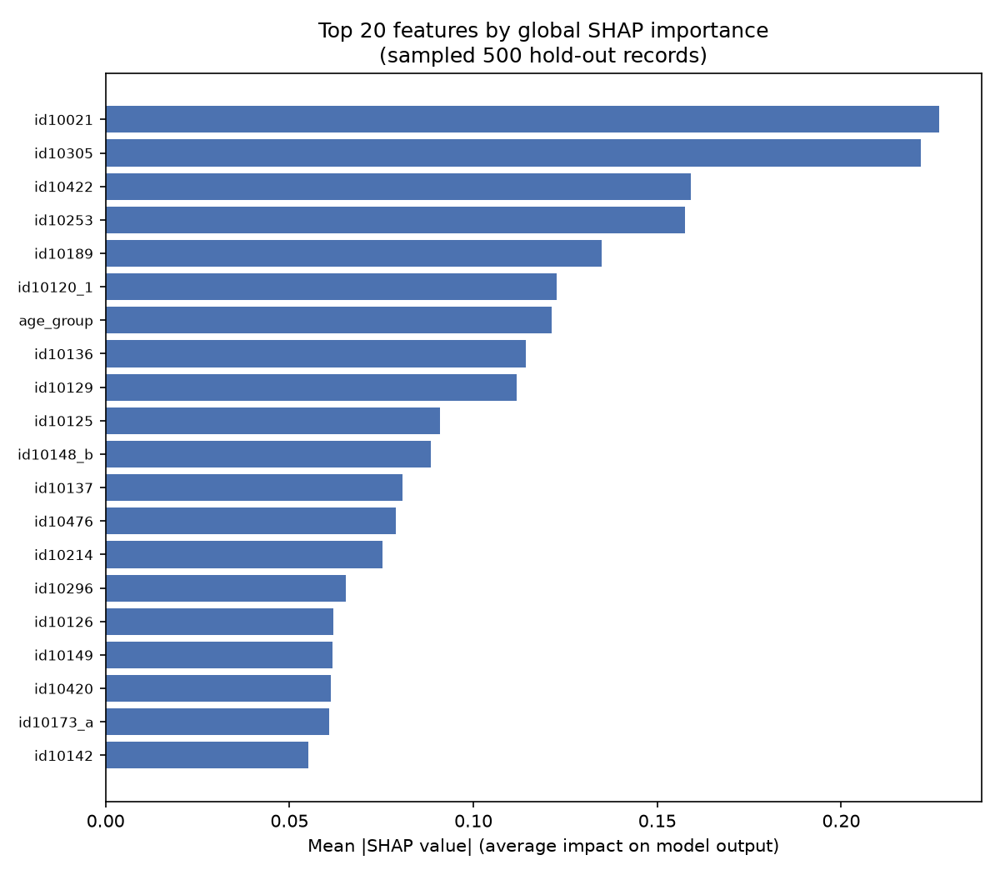

**Narrative embeddings vs. other features**

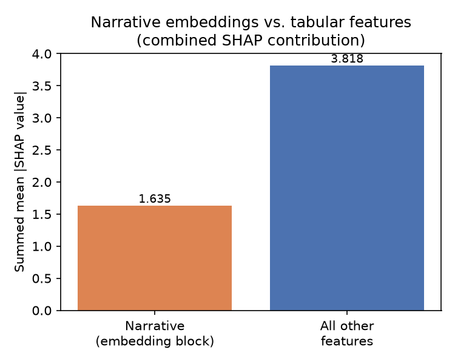

## Stratified SHAP Feature Importance

Feature importance split by sub-group — verbal autopsy predictors genuinely differ by who died of what (e.g. neonates vs. adults, or infectious vs. external-cause deaths). Collapsed by default; expand an axis to see its per-group panels.

Age Group

**Adult**

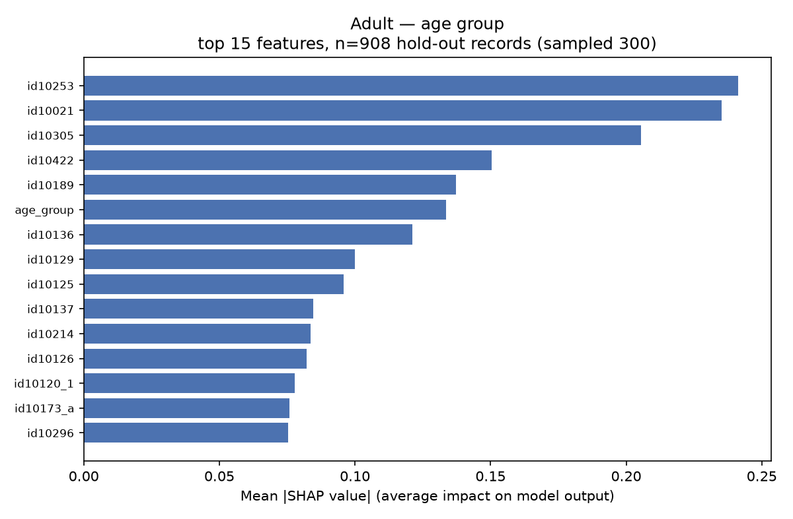

**Child**

**Neonate**

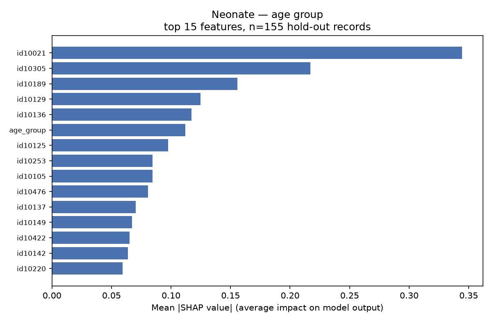

Sex

**Male**

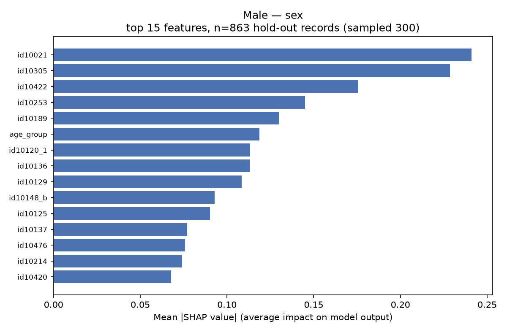

**Female**

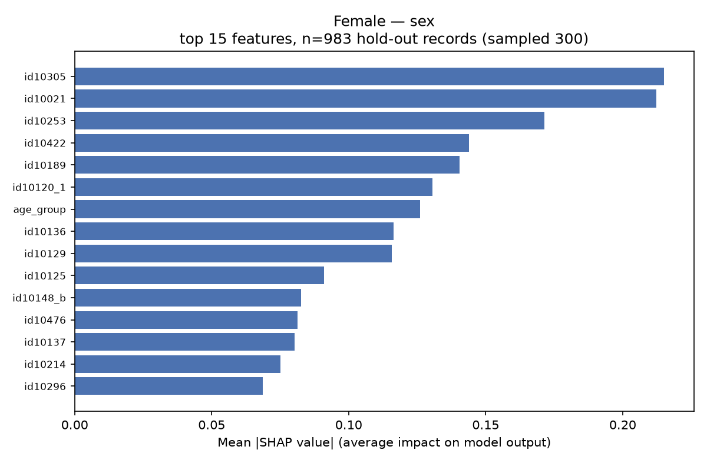

Cause Group

**Infectious and parasitic diseases**

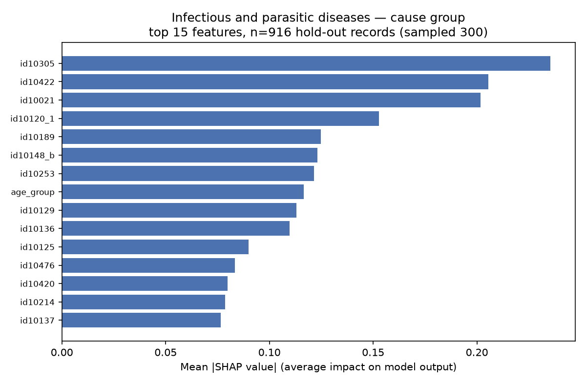

**Diseases of the circulatory system**

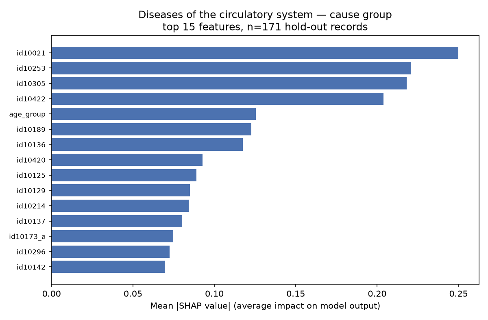

**Pregnancy-, childbirth- and puerperium-related disorders**

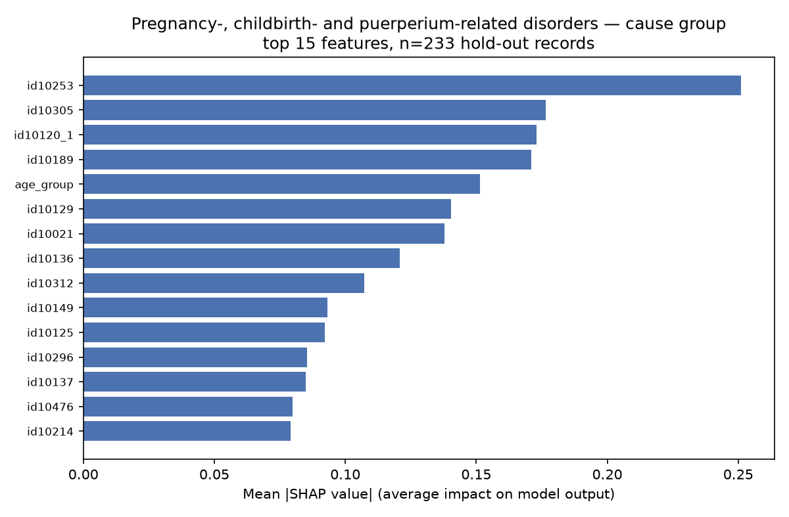

**Unknown and ill-defined**

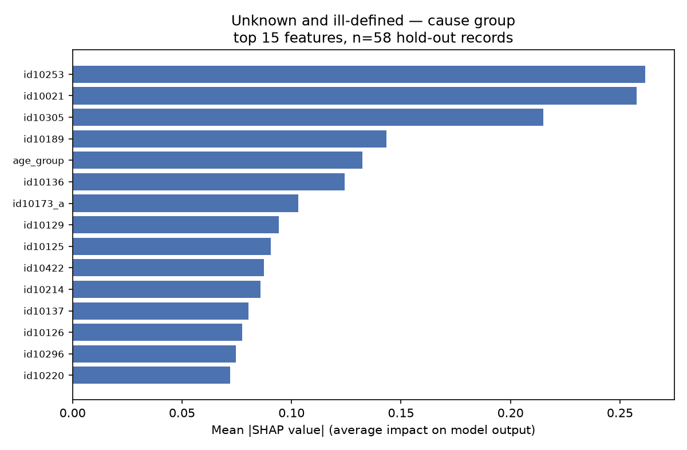

**Nutritional and endocrine disorders**

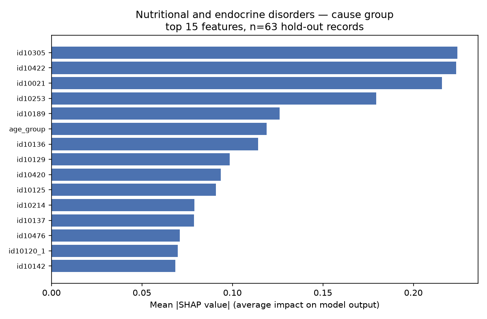

**Gastrointestinal disorders**

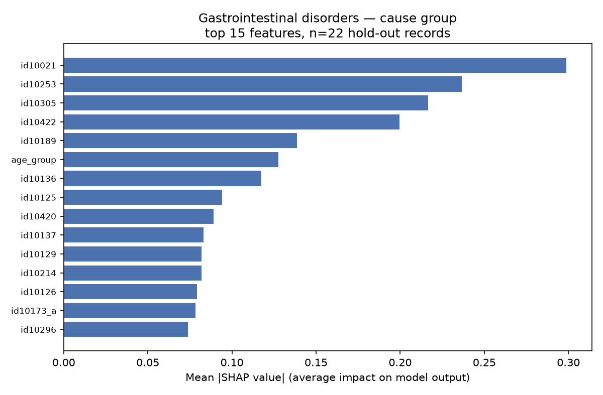

**External causes of death**

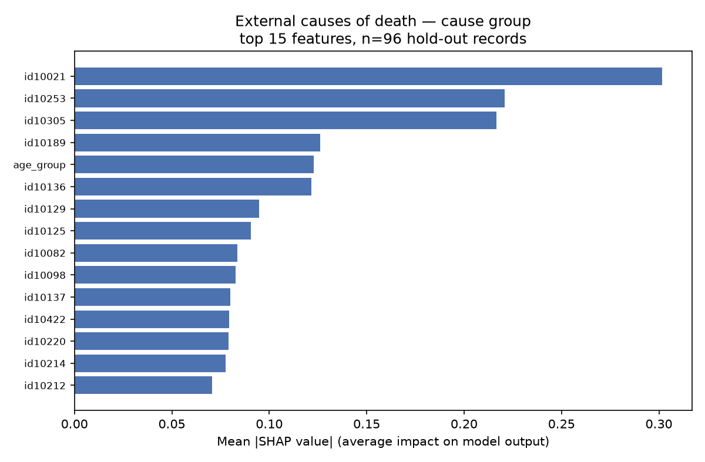

**Neoplasms**

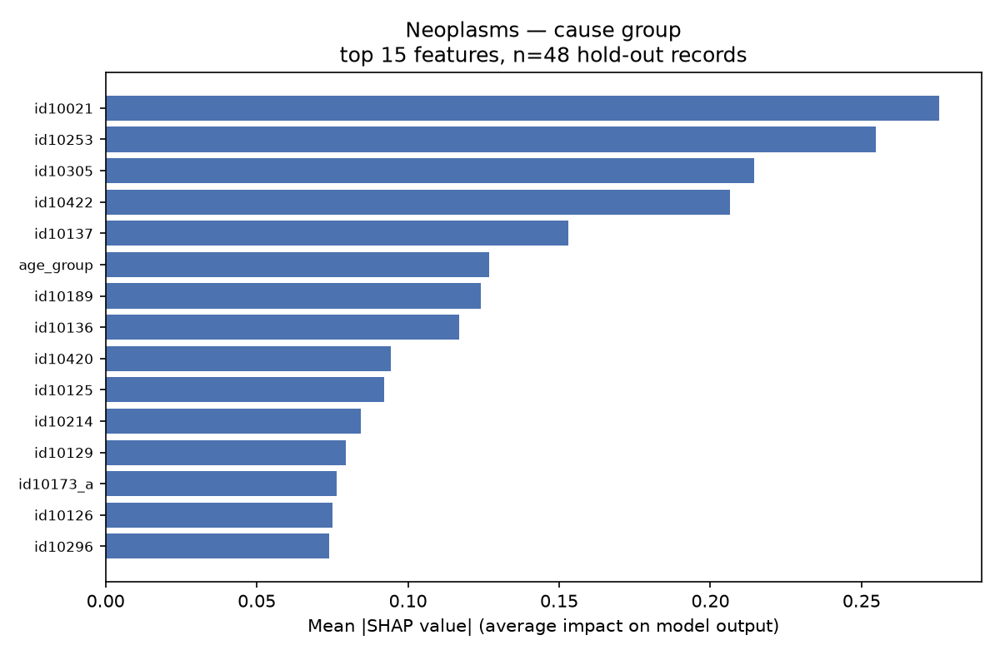

**Neonatal causes of death**

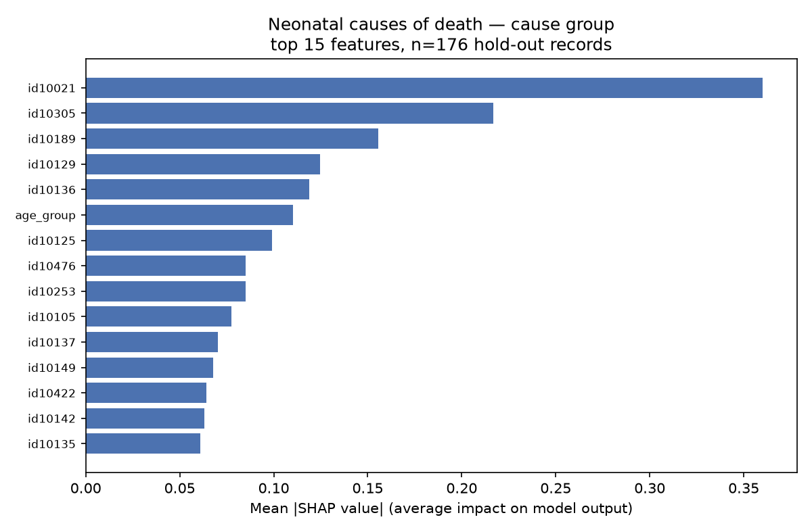

